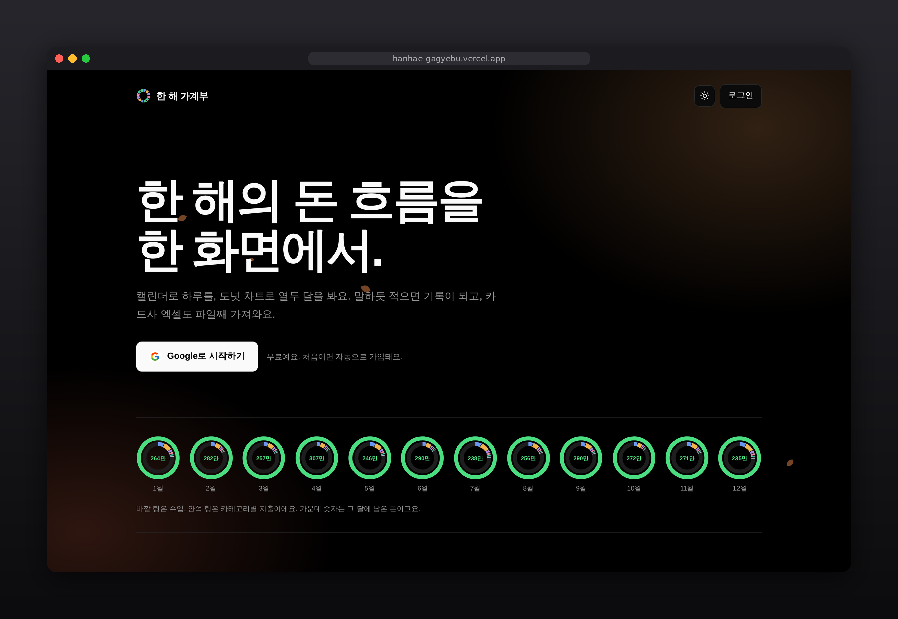
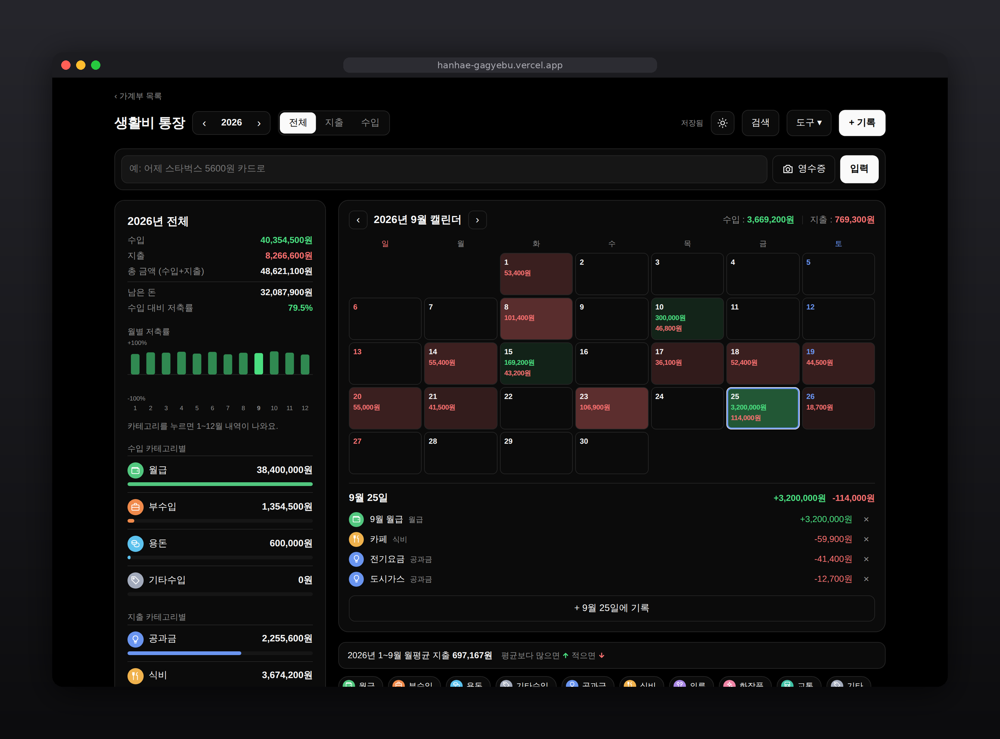
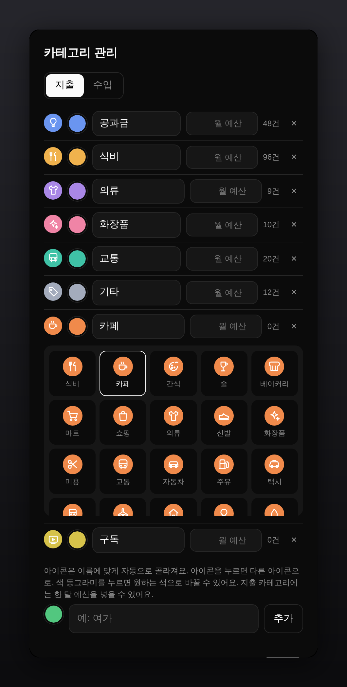
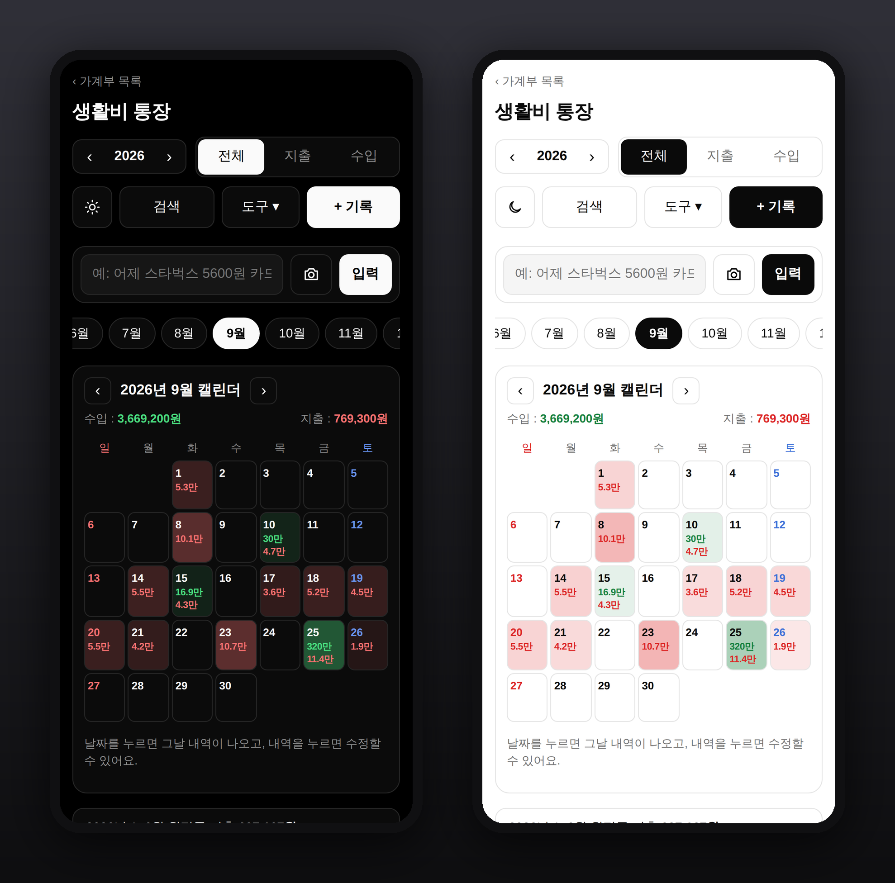
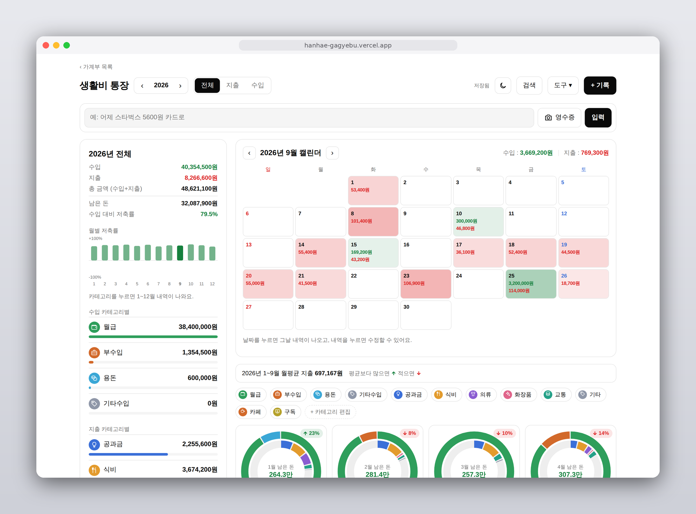

<div align="center">


# 한 해 가계부

**캘린더와 도넛 차트로 한 해의 수입·지출을 한눈에 보는 웹 가계부**

[🔗 hanhae-gagyebu.vercel.app](https://hanhae-gagyebu.vercel.app) · [개인정보처리방침](https://hanhae-gagyebu.vercel.app/privacy.html)

</div>

<p align="center"></p>

---

## 📸 화면

### 캘린더로 보는 하루하루
날마다 들어오고 나간 돈이 칸에 표시되고, 수익이 난 날은 초록, 많이 쓴 날일수록 진한 빨강으로 보여요. 날짜를 누르면 그날 내역이 카테고리 아이콘과 함께 나오고, 내역을 누르면 바로 수정할 수 있어요. 맨 위 입력칸에는 말하듯 적거나, 카메라 버튼으로 영수증을 찍어 기록할 수 있어요.



### 1~12월 도넛 차트
바깥 링은 수입, 안쪽 링은 지출 카테고리예요. 가운데에 그 달의 남은 돈이, 오른쪽 위에 누적 월평균 대비 ↑↓가 표시되고, 아래에 수입·지출·저축률이 정리돼요.

<p align="center"></p>

### 카테고리 상세
카테고리를 누르면 1~12월 내역과 월별 막대 그래프가 나오고, 캘린더와 도넛 차트도 그 카테고리 기준으로 바뀌어요.


### 카테고리 아이콘
카테고리 이름을 정하면 어울리는 아이콘이 자동으로 들어가요(카페 → 커피잔, 반려동물 → 발바닥 등). 아이콘을 누르면 55개 중에서 직접 고를 수 있고, 색도 자유롭게 바꿀 수 있어요.

<p align="center"></p>

### 모바일과 화이트·블랙 모드
폰에서도 그대로 쓸 수 있게 화면이 정리되고, 화이트·블랙 모드는 버튼 하나로 바꿀 수 있어요.

<p align="center"></p>



> 화면의 금액은 모두 예시 데이터예요.

---

## ✨ 주요 기능

### 기록하기
- **말로 입력** — "어제 스타벅스 5600원 카드로", "25일 월급 320만원 들어옴"처럼 적으면 날짜·금액·카테고리·결제수단을 알아서 채워요. 여러 건은 쉼표로 한 번에 입력할 수 있어요.
- **영수증 스캔 (AI)** — 입력칸 옆 카메라 버튼으로 사진을 찍거나 고르면, PaddleOCR 한국어 AI가 가게 이름, 날짜, 합계 금액, 결제수단(신용·체크·현금·할부), 상품명까지 읽어 확인 화면에 채워요. 사진은 서버로 보내지 않고 **기기 안에서만** 읽어요. 가게 이름이 여러 개로 읽히면 후보 버튼으로 한 번에 바꿀 수 있어요.
- **엑셀·CSV 가져오기** — 카드사·은행 거래내역 파일을 올리면 날짜·내용·금액 열을 자동으로 찾아요. 은행 CSV의 한글 깨짐(EUC-KR) 처리, 중복 내역 표시, 취소·환불 제외, 가맹점 이름으로 카테고리 추천과 학습까지 해요.
- **고정 지출·수입** — 관리비, 구독료, 월급, 적금처럼 매달 반복되는 항목을 등록하면 그날이 되면 자동으로 기록돼요.
- **수정·삭제·되돌리기** — 모든 내역을 눌러서 수정할 수 있고, 최근 15개 작업은 되돌릴 수 있어요. (Ctrl+Z 지원)

### 보기
- **캘린더** — 하루 단위 수입·지출과 그날 내역, 월별 수입·지출 합계
- **1~12월 도넛 차트** — 전체(수입+지출 이중 링)·지출·수입 보기 전환
- **누적 월평균 비교** — 선택한 달까지의 월평균 대비 각 달이 몇 % 늘고 줄었는지 ↑↓로 표시
- **연간 요약** — 수입·지출·총 금액·남은 돈·수입 대비 저축률, 월별 저축률 그래프
- **카테고리 상세** — 카테고리를 누르면 1~12월 내역과 월별 막대 그래프
- **검색** — 내용·카테고리·금액·기간으로 찾고 합계까지 바로 확인

### 관리하기
- **여러 가계부** — 통장·용도별로 따로 만들고, 전체 가계부 합산 보기도 가능
- **가계부 사이 이체** — 한쪽에서 기록하면 반대쪽에도 자동 기록되고, 수입·지출 계산에서는 빠져서 숫자가 부풀지 않아요
- **신용카드** — 결제수단·할부 기록, 사용일 기준(발생주의)과 결제일 기준(현금주의) 전환
- **예산** — 카테고리별 월 예산과 사용률(80% 주황, 초과 빨강)
- **시작 잔액** — 기준일 잔액을 넣으면 오늘 기준 통장 잔액 계산
- **연말정산 참고** — 신용카드·체크카드·현금 연간 사용액 합계
- **카테고리** — 추가·삭제·이름 변경, 이름에 어울리는 **아이콘(55종)과 색 자동 추천**, 직접 고르기

### 내보내기·백업
- **엑셀 내보내기** — 내역, 월별 요약, 카테고리별, 결제수단별 4개 시트
- **백업·복원** — 가계부 전체를 엑셀 파일 하나로 저장하고, 새 가계부로 안전하게 복원

### 앱처럼 쓰기
- **홈 화면에 설치** — 안드로이드는 버튼 한 번, 아이폰은 Safari "홈 화면에 추가"로 설치하면 주소창 없이 전체 화면 앱으로 열려요. 로그인 후 설치 안내가 나와요.
- **인터넷이 없어도 열림** — 앱 화면을 기기에 저장해 두고, 화면 파일은 항상 최신을 먼저 받아요. 가계부 데이터와 로그인 요청은 저장하지 않아요.
- **오프라인 기록과 자동 동기화** — 인터넷이 끊긴 동안 쓴 기록은 기기에 보관했다가, 연결되거나 앱으로 돌아오면 서버와 합쳐요. 기록마다 바꾼 시각과 지운 시각을 비교해서 폰과 PC의 변경이 서로 덮어써지지 않아요.
- **카카오톡 안내** — 카카오톡·인스타그램 등 앱 안에서 링크를 열면, 구글 로그인이 막힌다는 걸 알리고 기본 브라우저로 바로 열 수 있게 안내해요.

### 그 밖에
- 로그인 전 첫 화면 — 열두 달 도넛 링, 주요 기능 소개, 봄·여름·가을·겨울이 흘러가는 배경 (지금 계절부터 시작)
- 구글 계정 로그인, 폰과 PC 자동 동기화
- 화이트·블랙 모드 (기기 설정 자동 반영, 직접 전환 가능)
- 모바일 최적화 (아래에서 올라오는 메뉴, 좁은 화면용 금액 표시)
- 계정과 모든 데이터 즉시 삭제

---

## 🛠 기술 구성

| 영역 | 사용한 것 |
|---|---|
| 화면 | HTML · CSS · 순수 JavaScript (빌드 도구 없음) |
| 로그인 | Supabase Auth · Google OAuth (PKCE) |
| 데이터 저장 | Supabase Postgres (서울 리전) · 행 수준 보안(RLS) |
| 배포 | Vercel (정적 호스팅) |
| 앱 설치 | PWA (웹 앱 매니페스트 · 서비스 워커) |
| 엑셀 처리 | SheetJS Community Edition |
| 영수증 인식 | PaddleOCR (PP-OCRv5 한국어) + ONNX Runtime Web, 보조로 Tesseract.js — 모두 기기 안에서 WebAssembly로 실행 |
| 차트 | 직접 그린 SVG (외부 차트 라이브러리 없음) |

```
브라우저 ──(로그인)──▶ Google ─▶ Supabase Auth
   │
   └──(내 데이터만 읽기·쓰기, RLS)──▶ Supabase Postgres  [docs 테이블]
```

데이터는 가계부 하나당 `정보 문서 1개 + 연도별 기록 문서`로 나눠 저장해서, 여러 해를 써도 문서 하나가 커지지 않아요.

**영수증 인식 방식** — 서버 없이 폰 브라우저 안에서 AI가 돌아가요.
1. **종이만 잘라내기** — 사진에서 가장 밝은 영수증 부분만 남겨, 옆에 찍힌 키보드·책상 글자를 읽지 않게 해요.
2. **글자 줄 찾기** — PaddleOCR 위치 찾기(DB) 모델로 글자 줄을 찾고, 줄마다 기울어진 각도를 계산해요.
3. **줄마다 읽기** — 기울기에 맞춰 반듯하게 잘라 한국어 인식(PP-OCRv5) 모델로 읽어요. 확신이 92% 미만인 줄은 넓게 자르거나 진하게 바꿔 최대 세 번 더 읽고, 가장 확신 높은 결과를 써요.
4. **항목 고르기** — 금액은 "결제금액·승인금액", 그다음 "합계" 줄을 보고(부가세·포인트·승인번호 줄 제외), 날짜는 "판매일·거래일" 줄에서 찾아요. 가게 이름은 맨 위 이름과 "가맹점명" 줄 중 AI가 더 확신한 쪽을 쓰고, 상품명은 "상품명" 머리줄과 "합계" 사이의 한글 줄에서 골라 흔한 오인식(땅꽁→땅콩 등)을 바로잡아요.

AI 모델(약 16MB)은 처음 한 번만 받고 이후엔 기기에 저장돼요. AI 파일을 불러오지 못하면 Tesseract.js 간단 인식으로 자동 전환되고, 확인 화면에 원인이 표시돼요.

**동기화 방식** — 기록마다 마지막으로 바꾼 시각(`u`)을, 지운 기록은 지운 시각(`tomb`, 180일 보관)을 남겨요. 서버와 기기를 기록 단위로 비교해 더 최근 것을 남기고, 가계부 목록도 같은 방식으로 합쳐요. 자동 기록되는 고정 지출과 가계부 사이 이체는 어느 기기에서 만들어도 같은 번호를 받아 중복되지 않아요.

---

## 🔒 보안

[OWASP Top 10:2025](https://owasp.org/Top10/2025/) 기준으로 점검하고 보완했어요.

| 항목 | 적용한 대책 |
|---|---|
| A01 접근 제어 | 모든 테이블에 RLS, 본인 행만 읽기·쓰기. 계정 삭제도 본인만 가능한 함수로 처리 |
| A02 잘못된 설정 | CSP(인라인 스크립트 차단, 영수증 AI용 WebAssembly 실행만 허용), X-Frame-Options, HSTS, nosniff, Referrer-Policy, Permissions-Policy |
| A03 공급망 | 외부 라이브러리를 저장소에 직접 포함(`web/vender`)하고 버전 고정. 실행 중 외부 CDN 스크립트 없음 |
| A04 암호화 | 전 구간 HTTPS, 비밀번호를 보관하지 않음(구글 로그인만 사용) |
| A05 인젝션 | 화면 출력 이스케이프, 불러오는 모든 데이터(서버·로컬·백업 파일)를 허용 목록 방식으로 검증 |
| A06 설계 | 사용자당 문서 100개·전체 5MB 저장 한도로 남용 방지 |
| A07 인증 | Google OAuth + PKCE, 로그인 후 주소의 일회용 코드 자동 제거, 확실한 로그아웃 |
| A08 무결성 | 백업 복원 시 데이터 구조 검증, 복원은 항상 새 가계부로. 동기화 시 서버·기기 데이터를 모두 같은 검증을 거쳐 합침 |
| A10 예외 처리 | 서버 저장 실패 시 기기에 보관하고 안내, 한도 초과는 막고 알림 |

영수증 사진은 서버나 외부 서비스로 전송하지 않고 기기 안에서만 처리하며, 저장하지도 않아요.

앱 안 브라우저(카카오톡 등)에서는 구글 정책상 로그인이 막혀 있어서, 해당 환경을 감지해 외부 브라우저로 안내해요. 서비스 워커는 같은 사이트의 화면 파일만 다루고, Supabase·구글 요청과 로그인 코드가 담긴 주소는 저장하지 않아요.

관리 계정(GitHub·Google)은 2단계 인증을 사용해요.

### 🔑 비밀값과 키 관리

브라우저에 나가는 값과 서버에만 있는 값을 나눠 두었어요. 저장소에는 공개돼도 되는 값만 있어요.

| 값 | 어디에 있나 | 공개 여부 |
|---|---|---|
| Supabase 주소 · Publishable 키 | `web/config.js` | 공개 — 데이터는 RLS로 보호 |
| Secret(service_role) 키 | Edge Function 환경변수 (Supabase가 자동으로 넣음) | 비공개 — 저장소·브라우저에 없음 |
| Anthropic API 키 | Edge Function 비밀값 (`supabase secrets set`) | 비공개 — AI 기능이 꺼져 있어 지금은 설정 안 함 |
| Google OAuth 클라이언트 시크릿 | Supabase Auth의 Google 설정 | 비공개 |
| DB 비밀번호 | 앱은 쓰지 않음 (키와 RLS로만 접속) | 비공개 |

- 비밀값은 저장소나 메모 앱이 아니라 2단계 인증을 켠 비밀번호 관리자에만 보관해요.
- 노출이 의심되면 지우기만 하지 않고 새로 발급해서 바꿔요. 지운 값도 이미 복사됐을 수 있기 때문이에요.

### 🧱 서버 함수 보호

AI 기능(`functions/claude`)과 계정 삭제(`functions/delete-account`)는 서버 함수에서 처리해요.

- **로그인 확인** — 요청의 로그인 토큰을 Supabase에서 검증하고, 사용자 ID는 토큰에서만 정해요. 요청 본문에 적힌 ID는 쓰지 않아요.
- **정해진 작업만** — AI 함수는 `parse`(문장 정리)와 `report`(월간 리포트) 두 작업만 받고, 요청은 1만 2천 자, 입력 문장은 500자까지만 받아요.
- **비용 보호** — 하루 사용 횟수를 `ai_usage` 테이블에 세요. 사용자는 이 표를 직접 고칠 수 없고, `security definer` 함수로만 1씩 늘어나요.
- **프롬프트 인젝션 대비** — 사용자 문장은 `<sentence>` 태그로 감싸 "지시가 아닌 데이터"로 넘기고, AI의 답은 날짜 형식·금액 범위·허용된 값 목록을 통과한 항목만 화면으로 보내요. 모델이 속더라도 이상한 값이 저장되지 않게 하려는 거예요.
- **출처 제한과 시간 제한** — 허용한 사이트 주소(`ALLOWED_ORIGINS`)에서 온 요청만 받고, AI 호출은 30초가 지나면 끊어요. 오류가 나도 내부 정보는 응답에 담지 않아요.

### 🧯 키 교체 기록

**2026-11-20** — 개인 메모 앱에 평문으로 적어 둔 비밀값(DB 비밀번호, OAuth 시크릿, 계정 복구 코드)을 발견하고, 서비스를 멈추지 않고 모두 교체했어요.

1. Google OAuth — 새 시크릿 발급 → Supabase에 반영 → 로그인 정상 확인 → 예전 시크릿 삭제
2. DB 비밀번호 — 앱이 DB 비밀번호를 쓰지 않는 것을 코드에서 확인한 뒤 재설정
3. GitHub 복구 코드 — 새로 발급
4. 새 값은 비밀번호 관리자로 옮기고, 원래 메모는 휴지통까지 영구 삭제

교체 순서가 중요했어요. 새 값을 먼저 반영하고 동작을 확인한 다음 예전 값을 지워서 로그인이 끊기지 않았어요.

### 📝 알려진 한계와 다음 작업

- [ ] 계정 삭제에 쓰는 DB 함수 `delete_my_account`의 정의가 `schema.sql`에 빠져 있어요. 새 프로젝트에 배포하면 계정 삭제가 동작하지 않으니, 운영 DB에서 정의를 꺼내 추가할 예정이에요.
- [ ] 위 보안 표 A06의 저장 한도(문서 100개·전체 5MB)와 `schema.sql`의 값(문서 500개, 문서당 1MB)이 달라요. 운영 DB 기준으로 맞출게요.
- [ ] `functions/delete-account`는 지금 화면에서 쓰지 않아요(DB 함수를 씀). 하나로 정리할 예정이에요.
- [ ] Supabase의 예전(legacy) API 키가 2027년 초에 종료돼요. 서버 함수가 쓰는 `SUPABASE_ANON_KEY`·`SUPABASE_SERVICE_ROLE_KEY`를 새 키 방식으로 옮겨야 해요.
- [ ] 서버 함수는 `ALLOWED_ORIGINS`가 비어 있으면 모든 출처를 허용해요. 비어 있을 때는 거부하도록 바꿀게요.

---

## 📁 폴더 구조

```
web/                       정적 웹사이트 (Vercel 배포 폴더)
  index.html               화면 구조와 스타일
  app.js                   앱 전체 동작 (화면, 동기화, 가져오기·내보내기 등)
  theme.js                 화이트·블랙 모드 초기 적용
  config.js                Supabase 주소·공개 키
  privacy.html             개인정보처리방침
  vercel.json              보안 헤더, 서비스 워커 헤더
  manifest.webmanifest     앱 설치 정보 (이름, 아이콘, 색)
  sw.js                    서비스 워커 (오프라인 화면)
  icons/                   앱 아이콘 (192, 512, maskable, apple-touch, favicon)
  assets/                  첫 화면 이미지 (화이트·블랙용)
  vender/                  외부 라이브러리
    supabase.js            로그인·데이터 저장
    xlsx.full.min.js       엑셀 처리
    paddle/                영수증 AI (det.onnx, rec.onnx, dict.txt, ort.min.js, ort-wasm*.wasm)
    tesseract/             영수증 간단 인식 (보조용)
supabase/
  schema.sql               새 프로젝트용 테이블·보안 규칙
  functions/claude/        AI 기능용 서버 함수 (현재 꺼져 있음)
  functions/delete-account/ 계정 삭제용 서버 함수 (현재 쓰지 않음)
docs/screenshots/          README 이미지
```

---

## 🚀 직접 배포하기

### 1. Supabase
1. [supabase.com](https://supabase.com)에서 프로젝트 생성 (리전: Northeast Asia (Seoul))
2. **SQL Editor**에서 `supabase/schema.sql` 실행
3. **Authentication → Sign In / Providers**에서 Google을 켜고, Email은 끄기
4. **Authentication → URL Configuration**에 배포 주소를 Site URL과 Redirect URLs로 등록

### 2. Google 로그인
1. [Google Cloud Console](https://console.cloud.google.com)에서 프로젝트 생성
2. **Google 인증 플랫폼 → 브랜딩**에 앱 이름, 홈페이지, 개인정보처리방침, 승인된 도메인 입력
3. **클라이언트**에서 웹 애플리케이션 클라이언트 생성
   - 승인된 자바스크립트 원본: `https://<배포 주소>`
   - 승인된 리디렉션 URI: `https://<프로젝트REF>.supabase.co/auth/v1/callback`
4. 클라이언트 ID·보안 비밀번호를 Supabase Google 설정에 입력
5. **대상**에서 앱 게시(프로덕션)

### 3. 웹 설정
- `web/config.js`에 Supabase Project URL과 Publishable(anon) 키 입력 — 공개돼도 되는 키예요. **service_role·secret 키는 절대 넣지 마세요.**
- `web/vercel.json`의 CSP `connect-src`에 내 Supabase 주소 입력
- `web/vender/`에 외부 라이브러리 넣기
  - `supabase.js`, `xlsx.full.min.js` — `web/vender/README.txt` 참고
  - `paddle/` 폴더 6개 파일 — `web/vender/paddle/README.txt` 참고 (파일 이름을 정확히 맞춰주세요. 브라우저가 `languages_korean_dict.txt`처럼 이름을 바꿔 저장하면 `dict.txt`로 고쳐야 해요)
  - `tesseract/` 폴더 6개 파일 — `web/vender/tesseract/README.txt` 참고 (`.gz` 파일은 압축을 풀지 말고 그대로)

### 4. Vercel
저장소를 가져와 **Root Directory를 `web`**, Framework Preset을 **Other**로 두고 배포하면 끝이에요. 이후 GitHub에 올리면 자동으로 다시 배포돼요.

화면 파일을 크게 바꿨을 때는 `web/sw.js`의 `CACHE` 이름(예: `gagyebu-shell-v2` → `v3`)을 하나 올려주면, 설치된 앱에 남은 예전 저장본이 깔끔하게 정리돼요.

---

## 🗺 앞으로

- [x] 로그인 전 첫 화면
- [x] 앱 설치(PWA)와 오프라인 사용
- [x] 오프라인 기록 보존과 기기 간 동기화
- [ ] 함께 쓰는 가계부 (커플·가족)
- [ ] 저축 목표, 작년 같은 달과 비교
- [x] 영수증 사진 인식 입력 (PaddleOCR AI, 기기 안 처리, 무료)
- [x] 첫 화면 사계절 배경
- [ ] 손글씨 메모 사진 인식 (정확도 높은 인식 서비스 검토)
- [ ] 로봇 가입 방지(캡차)
- [ ] AI 월간 소비 리포트 (코드는 준비됨, 비용 문제로 꺼둠)

---

## 📄 사용한 오픈소스

- [supabase-js](https://github.com/supabase/supabase-js) — MIT
- [SheetJS Community Edition](https://sheetjs.com) — Apache 2.0
- [PaddleOCR](https://github.com/PaddlePaddle/PaddleOCR) — Apache 2.0 (ONNX 변환 모델: [monkt/paddleocr-onnx](https://huggingface.co/monkt/paddleocr-onnx), Apache 2.0)
- [ONNX Runtime Web](https://github.com/microsoft/onnxruntime) — MIT
- [Tesseract.js](https://github.com/naptha/tesseract.js) · [tesseract.js-core](https://github.com/naptha/tesseract.js-core) — Apache 2.0
- [Tesseract 학습 데이터 (kor, eng)](https://github.com/tesseract-ocr/tessdata) — Apache 2.0
- [IBM Plex Sans KR](https://github.com/IBM/plex) — SIL Open Font License

<div align="center">

Made by **Aqua**

</div>
