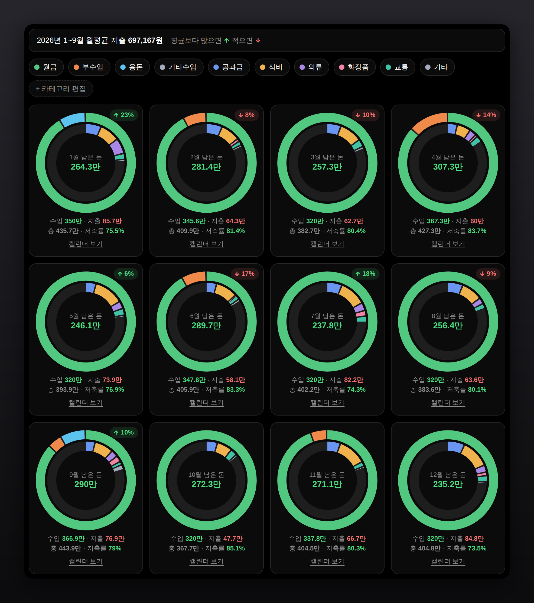
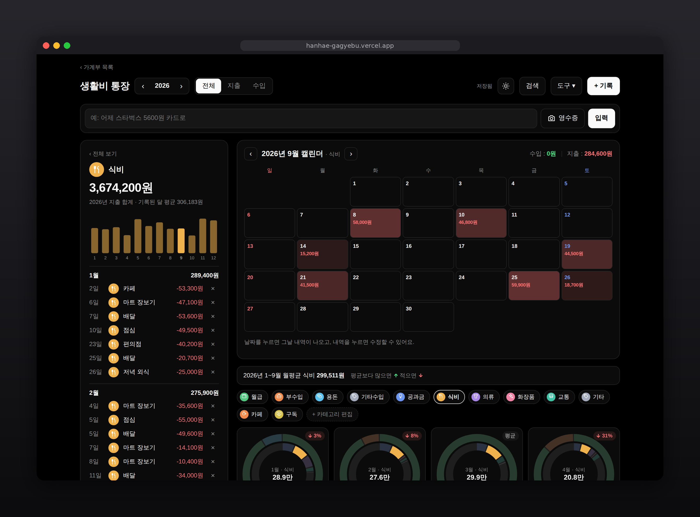

<div align="center">

# 💰 한 해 가계부

**캘린더와 도넛 차트로 한 해의 수입·지출을 한눈에 보는 웹 가계부**

[🔗 hanhae-gagyebu.vercel.app](https://hanhae-gagyebu.vercel.app) · [개인정보처리방침](https://hanhae-gagyebu.vercel.app/privacy.html)

</div>

---

## 📸 화면

### 캘린더로 보는 하루하루
날마다 들어오고 나간 돈이 칸에 표시되고, 수익이 난 날은 초록, 많이 쓴 날일수록 진한 빨강으로 보여요. 날짜를 누르면 그날 내역이 나오고, 내역을 누르면 바로 수정할 수 있어요.


### 1~12월 도넛 차트
바깥 링은 수입, 안쪽 링은 지출 카테고리예요. 가운데에 그 달의 남은 돈이, 오른쪽 위에 누적 월평균 대비 ↑↓가 표시되고, 아래에 수입·지출·저축률이 정리돼요.

<p align="center"></p>

### 카테고리 상세
카테고리를 누르면 1~12월 내역과 월별 막대 그래프가 나오고, 캘린더와 도넛 차트도 그 카테고리 기준으로 바뀌어요.



### 모바일과 화이트·블랙 모드
폰에서도 그대로 쓸 수 있게 화면이 정리되고, 화이트·블랙 모드는 버튼 하나로 바꿀 수 있어요.

<p align="center"></p>


> 화면의 금액은 모두 예시 데이터예요.

---

## ✨ 주요 기능

### 기록하기
- **말로 입력** — "어제 스타벅스 5600원 카드로", "25일 월급 320만원 들어옴"처럼 적으면 날짜·금액·카테고리·결제수단을 알아서 채워요. 여러 건은 쉼표로 한 번에 입력할 수 있어요.
- **엑셀·CSV 가져오기** — 카드사·은행 거래내역 파일을 올리면 날짜·내용·금액 열을 자동으로 찾아요. 은행 CSV의 한글 깨짐(EUC-KR) 처리, 중복 내역 표시, 취소·환불 제외, 가맹점 이름으로 카테고리 추천과 학습까지 해요.
- **고정 지출·수입** — 관리비, 구독료, 월급, 적금처럼 매달 반복되는 항목을 등록하면 그날이 되면 자동으로 기록돼요.
- **수정·삭제·되돌리기** — 모든 내역을 눌러서 수정할 수 있고, 최근 15개 작업은 되돌릴 수 있어요. (Ctrl+Z 지원)

### 보기
- **캘린더** — 하루 단위 수입·지출과 그날 내역, 월별 수입·지출 합계
- **1~12월 도넛 차트** — 전체(수입+지출 이중 링)·지출·수입 보기 전환
- **누적 월평균 비교** — 선택한 달까지의 월평균 대비 각 달이 몇 % 늘고 줄었는지 ↑↓로 표시
- **연간 요약** — 수입·지출·총 금액·남은 돈·수입 대비 저축률, 월별 저축률 그래프
- **카테고리 상세** — 카테고리를 누르면 1~12월 내역과 월별 막대 그래프
- **검색** — 내용·카테고리·금액·기간으로 찾고 합계까지 바로 확인

### 관리하기
- **여러 가계부** — 통장·용도별로 따로 만들고, 전체 가계부 합산 보기도 가능
- **가계부 사이 이체** — 한쪽에서 기록하면 반대쪽에도 자동 기록되고, 수입·지출 계산에서는 빠져서 숫자가 부풀지 않아요
- **신용카드** — 결제수단·할부 기록, 사용일 기준(발생주의)과 결제일 기준(현금주의) 전환
- **예산** — 카테고리별 월 예산과 사용률(80% 주황, 초과 빨강)
- **시작 잔액** — 기준일 잔액을 넣으면 오늘 기준 통장 잔액 계산
- **연말정산 참고** — 신용카드·체크카드·현금 연간 사용액 합계
- **카테고리** — 추가·삭제·이름 변경, 이름에 어울리는 색 자동 추천과 자유로운 색 선택

### 내보내기·백업
- **엑셀 내보내기** — 내역, 월별 요약, 카테고리별, 결제수단별 4개 시트
- **백업·복원** — 가계부 전체를 엑셀 파일 하나로 저장하고, 새 가계부로 안전하게 복원

### 그 밖에
- 구글 계정 로그인, 폰과 PC 자동 동기화
- 화이트·블랙 모드 (기기 설정 자동 반영, 직접 전환 가능)
- 모바일 최적화 (아래에서 올라오는 메뉴, 좁은 화면용 금액 표시)
- 계정과 모든 데이터 즉시 삭제

---

## 🛠 기술 구성

| 영역 | 사용한 것 |
|---|---|
| 화면 | HTML · CSS · 순수 JavaScript (빌드 도구 없음) |
| 로그인 | Supabase Auth · Google OAuth (PKCE) |
| 데이터 저장 | Supabase Postgres (서울 리전) · 행 수준 보안(RLS) |
| 배포 | Vercel (정적 호스팅) |
| 엑셀 처리 | SheetJS Community Edition |
| 차트 | 직접 그린 SVG (외부 차트 라이브러리 없음) |

```
브라우저 ──(로그인)──▶ Google ─▶ Supabase Auth
   │
   └──(내 데이터만 읽기·쓰기, RLS)──▶ Supabase Postgres  [docs 테이블]
```

데이터는 가계부 하나당 `정보 문서 1개 + 연도별 기록 문서`로 나눠 저장해서, 여러 해를 써도 문서 하나가 커지지 않아요.

---

## 🔒 보안

[OWASP Top 10:2025](https://owasp.org/Top10/2025/) 기준으로 점검하고 보완했어요.

| 항목 | 적용한 대책 |
|---|---|
| A01 접근 제어 | 모든 테이블에 RLS, 본인 행만 읽기·쓰기. 계정 삭제도 본인만 가능한 함수로 처리 |
| A02 잘못된 설정 | CSP(인라인 스크립트 차단), X-Frame-Options, HSTS, nosniff, Referrer-Policy, Permissions-Policy |
| A03 공급망 | 외부 라이브러리를 저장소에 직접 포함(`web/vender`)하고 버전 고정. 실행 중 외부 CDN 스크립트 없음 |
| A04 암호화 | 전 구간 HTTPS, 비밀번호를 보관하지 않음(구글 로그인만 사용) |
| A05 인젝션 | 화면 출력 이스케이프, 불러오는 모든 데이터(서버·로컬·백업 파일)를 허용 목록 방식으로 검증 |
| A06 설계 | 사용자당 문서 100개·전체 5MB 저장 한도로 남용 방지 |
| A07 인증 | Google OAuth + PKCE, 로그인 후 주소의 일회용 코드 자동 제거, 확실한 로그아웃 |
| A08 무결성 | 백업 복원 시 데이터 구조 검증, 복원은 항상 새 가계부로 |
| A10 예외 처리 | 서버 저장 실패 시 기기에 보관하고 안내, 한도 초과는 막고 알림 |

관리 계정(GitHub·Google)은 2단계 인증을 사용해요.

---

## 📁 폴더 구조

```
web/                       정적 웹사이트 (Vercel 배포 폴더)
  index.html               화면 구조와 스타일
  app.js                   앱 전체 동작
  theme.js                 화이트·블랙 모드 초기 적용
  config.js                Supabase 주소·공개 키
  privacy.html             개인정보처리방침
  vercel.json              보안 헤더
  vender/                  외부 라이브러리 (supabase.js, xlsx.full.min.js)
supabase/
  schema.sql               새 프로젝트용 테이블·보안 규칙 전체
  security-update.sql      기존 프로젝트용 보안 업데이트
  functions/claude/        AI 기능용 서버 함수 (현재 꺼져 있음)
docs/screenshots/          README 이미지
```

---

## 🚀 직접 배포하기

### 1. Supabase
1. [supabase.com](https://supabase.com)에서 프로젝트 생성 (리전: Northeast Asia (Seoul))
2. **SQL Editor**에서 `supabase/schema.sql` 실행
3. **Authentication → Sign In / Providers**에서 Google을 켜고, Email은 끄기
4. **Authentication → URL Configuration**에 배포 주소를 Site URL과 Redirect URLs로 등록

### 2. Google 로그인
1. [Google Cloud Console](https://console.cloud.google.com)에서 프로젝트 생성
2. **Google 인증 플랫폼 → 브랜딩**에 앱 이름, 홈페이지, 개인정보처리방침, 승인된 도메인 입력
3. **클라이언트**에서 웹 애플리케이션 클라이언트 생성
   - 승인된 자바스크립트 원본: `https://<배포 주소>`
   - 승인된 리디렉션 URI: `https://<프로젝트REF>.supabase.co/auth/v1/callback`
4. 클라이언트 ID·보안 비밀번호를 Supabase Google 설정에 입력
5. **대상**에서 앱 게시(프로덕션)

### 3. 웹 설정
- `web/config.js`에 Supabase Project URL과 Publishable(anon) 키 입력 — 공개돼도 되는 키예요. **service_role·secret 키는 절대 넣지 마세요.**
- `web/vercel.json`의 CSP `connect-src`에 내 Supabase 주소 입력
- `web/vender/`에 라이브러리 두 파일 넣기 (`web/vender/README.txt` 참고)

### 4. Vercel
저장소를 가져와 **Root Directory를 `web`**, Framework Preset을 **Other**로 두고 배포하면 끝이에요. 이후 GitHub에 올리면 자동으로 다시 배포돼요.

---

## 🗺 앞으로

- [ ] 영수증·손글씨 사진 인식 입력 (무료 OCR 방식 검토 중)
- [ ] 로봇 가입 방지(캡차)
- [ ] AI 월간 소비 리포트 (코드는 준비됨, 비용 문제로 꺼둠)

---

## 📄 사용한 오픈소스

- [supabase-js](https://github.com/supabase/supabase-js) — MIT
- [SheetJS Community Edition](https://sheetjs.com) — Apache 2.0
- [IBM Plex Sans KR](https://github.com/IBM/plex) — SIL Open Font License

<div align="center">

Made by **Aqua**

</div>
